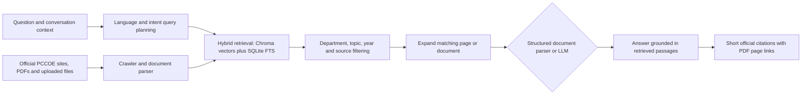

# PCCOE College Knowledge Assistant

A locally run PCCOE student assistant with a persistent Chroma vector index, a source-grounded chat API, and the existing PCCOE report-style React interface.

## Start the project

1. Install Python 3.11+ dependencies with `pip install -r requirements.txt` and JavaScript dependencies with `npm install`.
2. Copy `.env.example` to `.env`. With `LLM_PROVIDER=auto`, the app uses Gemini when `GEMINI_API_KEY` is set, otherwise Groq when `GROQ_API_KEY` is set, and otherwise a local extractive answerer. You can set `LLM_PROVIDER=gemini`, `groq`, or `mock` to explicitly select a provider.
3. Set a private, long random `ADMIN_TOKEN` in `.env` before using the update action. Admin sync is disabled when the token is empty.
4. Start the API with `uvicorn app.main:app --reload --port 8000`.
5. In a second terminal, run `npm run dev`; open the Vite URL printed in that terminal.

Keep `.env` private. The API keys previously pasted in chat should be revoked and replaced; they are not included in this project.

## PCCOE source updates

On a fresh install, the API starts its first source crawl at startup. Use **Update Info** for later refreshes. The crawler follows official `pccoepune.com` links and configured department seed URLs, includes PDFs, DOCX, PPTX, XLSX, and CSV files, reads sitemap files, respects each host's `robots.txt`, and has a configurable page cap (`MAX_CRAWL_PAGES`, default 5,000 new pages per run). A detailed queue checkpoint and compact status report are persisted under `data/`; interrupted crawls resume on the next API startup, and capped crawls continue in later batches. The status endpoint is `GET /api/scraper/status`; indexed-source inventory is `GET /api/sources`; host, department, and topic coverage is `GET /api/coverage`. Changed chunks are re-embedded; unchanged chunks are retained. A daily crawl is enabled by default (`CRAWL_INTERVAL_HOURS=24`; set to `0` to disable it).

Seed URLs include department syllabus listings, the official fee structure, academic calendar and exam timetable pages, and selected syllabus documents so key resources do not depend on homepage discovery. Add another URL to `SEED_URLS` in `.env` when a PCCOE resource is not linked from crawlable pages. Coverage is bounded by the official domains in `ALLOWED_DOMAINS`, available links and sitemaps, host availability, the page cap, and each host's `robots.txt`. A `partial` result reports errors or skipped items and must not be presented as complete coverage. A robots disallow is respected; ask the site owner for an export or permission if an important department host blocks crawling. The app cannot guarantee literally every PCCOE page or file is indexed, but persistent progress and per-host counts make uncovered areas visible rather than silently treating a partial crawl as complete.

The single PCCOE Knowledge Agent uses retrieval-augmented generation (RAG); it does not need model training on the college website. It searches Chroma vectors and a persistent SQLite full-text index, expands matched source pages for list requests, then answers from cited evidence. With an API key, the model receives the relevant passages; without one, the app uses a local extractive answerer. Link-label-only snippets are excluded from answer text so navigation links are not presented as document facts. Answers should be checked against the linked official source. The sample question bank is a retrieval coverage checklist, not institutional content. Run `python -m app.evaluate` after indexing to create `data/evaluation_report.json`; it measures retrieval/source coverage, not factual correctness of a generated response.

Image-only PDFs with little or no extractable text can use the configured Gemini key for general OCR during ingestion. Without that key, image-only content cannot be parsed. Model answers use a valid provider key from the local `.env`; keys stay on the API server and are never sent to the browser. API docs are at `http://127.0.0.1:8000/docs`. Admin routes use the `X-Admin-Token` header.

## How answers are produced

The language model does not train on, or memorize, the college website. It helps plan multilingual searches and compose answers from retrieved evidence. Source pages and PDFs still need to be indexed; the model is instructed to abstain when matching evidence is absent. The current crawler is PCCOE-domain scoped, respects robots rules and is not an unrestricted live web search engine.

## Audit checkpoint

On 2026-10-16, the live retrieval pipeline was measured against 104 English, Hindi, Hinglish and Marathi questions across 26 student-information topics. The index had 15,395 chunks. It found an official, topic-relevant PCCOE passage for 80/104 queries (77%). By language: English 21/26, Hindi 20/26, Hinglish 20/26, Marathi 19/26. This is a retrieval-coverage proxy only; it does not measure factual answer correctness. See `data/evaluation_report.json` for the query-level report.

The audit found incomplete indexed coverage for parents/guardians, hostel, placements, transportation and notices, among other topics. The Computer Engineering faculty profile URL in the current index says “Not Found” and includes a Teaching Assistant record only; the app now reports that gap instead of labeling the person as a faculty roster. The mechanical subdomain previously disallowed crawling via its robots file, so that data cannot be filled by the crawler unless the site changes its policy. Official 2026-27 fee PDFs have now been added as explicit seeds so the next sync can parse their category-wise tables.

Current local verification: 12 backend tests pass, the frontend production build succeeds, and representative live questions return document-grounded answers for Mechanical HOD, Computer placements, engineering fees and Research Methodology. The health endpoint currently reports `provider: mock`, meaning no Gemini/Groq/Ollama model is configured in this workspace; extractive PCCOE answers still work, but general-purpose model answers require a key in the server `.env`. API keys previously pasted in chat should be revoked and replaced.
