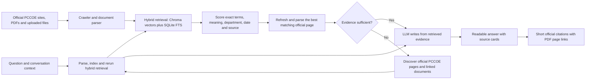

# PCCOE College Knowledge Assistant

A locally run PCCOE student assistant with a persistent Chroma vector index, a source-grounded chat API, and the existing PCCOE report-style React interface.

## Start the project

1. Install Python 3.11+ dependencies with `pip install -r requirements.txt` and JavaScript dependencies with `npm install`.
2. Copy `.env.example` to `.env`. With `LLM_PROVIDER=auto`, the app uses Gemini when `GEMINI_API_KEY` is set, otherwise Groq when `GROQ_API_KEY` is set, and otherwise a local extractive answerer. You can set `LLM_PROVIDER=gemini`, `groq`, or `mock` to explicitly select a provider.
3. Set a private, long random `ADMIN_TOKEN` in `.env` before using the update action. Admin sync is disabled when the token is empty.
4. Start the API with `uvicorn app.main:app --reload --port 8000`.
5. In a second terminal, run `npm run dev`; open the Vite URL printed in that terminal.

Keep `.env` private. The API keys previously pasted in chat should be revoked and replaced; they are not included in this project.

## PCCOE source updates

Use the chat menu's **Start / resume PCCOE crawl** and **Stop PCCOE crawl** controls (the current labels for the older “Update Info” action) to manage an update; both require the private `ADMIN_TOKEN` from the API's `.env`. Stop is cooperative: the current page finishes and the remaining queue is checkpointed. Partial or stopped crawls resume after an API restart, and starting a fresh pass also revisits configured seed URLs instead of retrying only recent failures.

On a fresh install, the API starts its first source crawl at startup. Use **Update Info** for later refreshes. The crawler follows official `pccoepune.com` links and configured department seed URLs, includes PDFs, DOCX, PPTX, XLSX, CSV and JSON data, reads sitemap files, respects each host's `robots.txt`, follows redirects only when they stay on allowed PCCOE domains, and has a configurable page cap (`MAX_CRAWL_PAGES`, default 5,000 new pages per batch). If a frontier exceeds the cap, the next batch starts automatically; the persisted queue also resumes after an API restart. Non-text static assets such as images, stylesheets, and scripts are filtered from the crawl queue; linked documents, data files, and readable pages remain eligible. HTML extraction also reads JSON-LD and common application-state payloads, discovers linked data/document URLs embedded in page scripts, and fetches a bounded number of same-host data scripts on sparse or topic pages. Script records are normalized into searchable text before chunking. Transient network failures are retried up to two times during a run and remain eligible for a later scheduled/manual retry; this includes temporary DNS and OCR-provider quota/rate-limit failures. Large documents use a longer bounded read timeout. A detailed queue checkpoint and compact status report are persisted under `data/`; interrupted crawls resume on the next API startup. The status endpoint is `GET /api/scraper/status`; indexed-source inventory is paginated with `GET /api/sources?limit=500&offset=0`; host, department, and topic coverage is `GET /api/coverage`. The audit endpoints read Chroma's local metadata in a read-only SQL snapshot for a quick full-index audit, with paginated Chroma API reads as a compatibility fallback when the local database schema changes; temporary index locks return a retryable service error instead of starting a potentially unbounded scan. Crawl status reports pending counts by host and file type, as well as robots exclusions and recent failures. Changed chunks are re-embedded; unchanged chunks are retained. A daily crawl is enabled by default (`CRAWL_INTERVAL_HOURS=24`; set to `0` to disable it).

Seed URLs include department syllabus listings, official fee/calendar/exam pages, selected syllabus documents, and the core B.Tech admission, institute-level admission, against-CAP admission and cutoff pages. These core admission pages are always added to the crawl queue, even when a local `SEED_URLS` setting is customized. Add another URL to `SEED_URLS` in `.env` when a PCCOE resource is not linked from crawlable pages. Coverage is bounded by the official domains in `ALLOWED_DOMAINS`, available links and sitemaps, host availability, the page cap, and each host's `robots.txt`. A `partial` result reports errors or skipped items and must not be presented as complete coverage. A robots disallow is respected; ask the site owner for an export or permission if an important department host blocks crawling. The app cannot guarantee literally every PCCOE page or file is indexed, but persistent progress and per-host counts make uncovered areas visible rather than silently treating a partial crawl as complete.

The single PCCOE Knowledge Agent uses retrieval-augmented generation; it does not train a model on the college website. With an LLM provider configured, the model planner receives the latest 12 user/assistant question-and-answer pairs and the current request, then decides dynamically whether it has enough context to search, whether a targeted follow-up is necessary, and which PCCOE search queries should cover every part of the request. It does not use a fixed list of clarification questions; lightweight local rules are the fallback when model planning is unavailable. The agent searches persistent Chroma vectors and SQLite FTS5 exact terms, expands matching official source pages, and asks the configured LLM to compose an answer grounded in citations. Conversation history resolves references but previous assistant answers are not factual evidence. Policy answers must identify the applicable program, regulation and date, distinguish documented thresholds, consequences and exceptions, and avoid treating one program's rule as universal. The most relevant source page is refreshed on demand (with a short URL cooldown) and re-parsed before answering. If indexed evidence is weak, `LIVE_WEB_FALLBACK=true` uses Gemini Google Search grounding or Groq browser search to discover official PCCOE URLs, fetches and parses those pages/documents and a small number of query-relevant linked resources, indexes them, then reruns hybrid retrieval and grounded generation. The search model's generated text is never treated as evidence. HTML, JSON-LD, application-state JSON, structured JavaScript, PDFs, Office documents, CSV and JSON resources use the same index and answer flow. If live search is unavailable, the assistant falls back to indexed evidence or states what context is missing instead of turning adjacent material into an answer. Link-label-only snippets are excluded from answer text. Run `python -m app.evaluate` after indexing to create `data/evaluation_report.json`; it measures retrieval/source coverage, not factual correctness of generated responses.

Image-only PDFs with little or no extractable text can use Gemini OCR, with a configured Groq vision model (`GROQ_OCR_MODEL`, default `qwen/qwen3.8-27b`) as a fallback. Pages are sent in bounded batches to avoid timing out on large scanned rosters; an OCR failure is recorded as a crawl failure rather than silently treating the PDF as indexed, and a seeded faculty roster missing from the index is retried on resume. Without either configured key, image-only content cannot be parsed. Model answers use valid provider keys from the local `.env`; keys stay on the API server and are never sent to the browser. API docs are at `http://127.0.0.1:8000/docs`. Admin routes use the `X-Admin-Token` header.

## How answers are produced

The language model does not train on, or memorize, the college website. It composes answers from retrieved evidence and can trigger dynamic source discovery when the indexed match is weak. The crawler remains PCCOE-domain scoped and respects each host's robots rules. Coverage depends on public links/sitemaps, host availability, provider search quotas and the configured crawl cap; the status and coverage endpoints report what has actually been indexed.

## Audit checkpoint

Historical retrieval evaluation on 2026-10-16 covered 104 English, Hindi, Hinglish and Marathi questions and found topic-relevant passages for 80 (77%). This was a retrieval-coverage proxy, not a factual-answer evaluation, and predates the current larger index and query-time refresh flow. Regenerate `data/evaluation_report.json` after the current crawl completes before using the historical score as a project metric.

The crawler respects robots.txt. If a PCCOE host blocks automated access, its pages are not scraped; query-time search can still discover accessible official pages elsewhere on PCCOE domains. Official 2026-27 fee PDFs are included as seeds.

Last recorded local health check reported the Gemini provider and 74,417 indexed chunks. Crawl status is persisted separately and may be partial; use `GET /api/scraper/status` and `GET /api/coverage` for the live counts. Model availability still depends on the keys and quotas in the server `.env`. API keys previously pasted in chat should be revoked and replaced.
